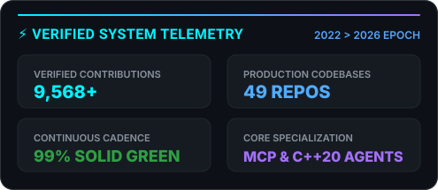
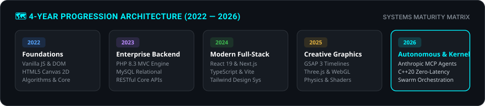

<!-- ======================================================= -->
<!-- HEADER BANNER: Capsule Render Wave Gradient             -->
<!-- ======================================================= -->

  

<!-- ======================================================= -->
<!-- TYPING SVG: Dynamic Subtitle & Positioning               -->
<!-- ======================================================= -->

  

<!-- ======================================================= -->
<!-- QUICK BADGES / VERIFICATION ROW                         -->
<!-- ======================================================= -->

  
  
  
  

 

<!-- ======================================================= -->
<!-- BENTO GRID SECTION: Row 1 (Bio & Verified Metrics)     -->
<!-- ======================================================= -->
<table align="center" width="100%" border="0" cellSpacing="10" cellPadding="0">
  <tr>
    <!-- Bento Box 1: Executive Mission & Core Identity -->
    <td width="50%" valign="top">
      

        <h3 style="margin-top: 0; color: #00f2fe;">⚡ Executive Architectural Overview</h3>
        
I build <b>high-throughput distributed platforms</b>, <b>kernel-grade security engines</b>, and <b>autonomous AI agent networks</b> driving core infrastructure at <b><a href="https://github.com/Fearlessversee">Taliyo Technologies</a></b>.

        <ul style="padding-left: 20px; line-height: 1.8;">
          <li>🔬 <b>Low-Latency Systems:</b> Sub-microsecond packet analysis, zero-copy buffers in <code>C++20</code>.</li>
          <li>🤖 <b>Autonomous Agent Swarms:</b> Anthropic <code>Model Context Protocol (MCP)</code> & multi-agent mesh.</li>
          <li>🚀 <b>Modern Web Ecosystems:</b> Distributed SaaS platforms, <code>React 19</code>, <code>Next.js 16</code>, <code>TypeScript</code>.</li>
          <li>🏛️ <b>Backend & Databases:</b> Enterprise <code>PHP 8.3 MVC</code>, <code>MySQL</code>, <code>FastAPI</code>, <code>Redis</code>.</li>
          <li>✨ <b>Creative Graphics:</b> Real-time <code>WebGL</code>, <code>GLSL Shaders</code>, and <code>Three.js</code> simulations.</li>
        </ul>
        
📫 <i>Available for strategic architecture advisory & high-scale enterprise engineering.</i>

      

    </td>

    <!-- Bento Box 2: Verified Live System Telemetry (Local SVG) -->
    <td width="50%" valign="top" align="center">
      

        
      

    </td>
  </tr>

  <!-- ======================================================= -->
  <!-- BENTO GRID SECTION: Row 2 (Tech Arsenal & Streak Card) -->
  <!-- ======================================================= -->
  <tr>
    <!-- Bento Box 3: Production Tech Stack (SkillIcons) -->
    <td width="50%" valign="top">
      

        <h3 style="margin-top: 0; color: #58a6ff;">🛠️ Production Technology Arsenal</h3>
        
Core languages, frameworks, cloud infrastructure & creative engines:

        
        

          
        

        

          <code>TypeScript</code> • <code>C++20</code> • <code>Python</code> • <code>PHP 8.3</code> • <code>React 19</code> • <code>Next.js 16</code> • <code>Docker</code> • <code>MCP</code>
        

      

    </td>

    <!-- Bento Box 4: Continuous Streak & Activity -->
    <td width="50%" valign="top" align="center">
      

        
      

    </td>
  </tr>
</table>

 

<!-- ======================================================= -->
<!-- VISUAL TIMELINE: 4-Year Technical Evolution (2022-2026) -->
<!-- ======================================================= -->

  

 

<!-- ======================================================= -->
<!-- FLAGSHIP ARCHITECTURAL REPOSITORIES SHOWCASE            -->
<!-- ======================================================= -->
<h2 align="center" style="color: #00f2fe;">🚀 Flagship Systems & Architectures</h2>

  Selected open-source systems engineered across low-latency security, autonomous AI, and high-frequency platforms:

<table align="center" width="100%" border="0" cellSpacing="0" cellPadding="8">
  <thead>
    <tr style="background-color: #161b22; color: #58a6ff; text-align: left; border-bottom: 2px solid #30363d;">
      <th width="32%">Repository & Domain</th>
      <th width="24%">Technology Stack</th>
      <th width="44%">Architectural Highlights</th>
    </tr>
  </thead>
  <tbody>
    <tr style="border-bottom: 1px solid #21262d;">
      <td>
        <b><a href="https://github.com/Fearlessversee/sub-microsecond-cyber-defense-appliance">🛡️ sub-microsecond-cyber-defense-appliance</a></b> 
        Low-Latency Security Appliance
      </td>
      <td><code>C++20</code> <code>RingBuffer</code> <code>SIMD</code></td>
      <td>Sub-microsecond malicious packet filtering, kernel-bypass state machines, and hardware-accelerated defense.</td>
    </tr>
    <tr style="border-bottom: 1px solid #21262d;">
      <td>
        <b><a href="https://github.com/Fearlessversee/autonomous-ai-ops-command-center">🤖 autonomous-ai-ops-command-center</a></b> 
        Agentic AI & Swarm DevOps
      </td>
      <td><code>MCP</code> <code>FastAPI</code> <code>Docker</code></td>
      <td>Multi-agent autonomous operations center orchestrating self-healing clusters and automated CI/CD diagnostics.</td>
    </tr>
    <tr style="border-bottom: 1px solid #21262d;">
      <td>
        <b><a href="https://github.com/Fearlessversee/react-enterprise-analytics-suite">📊 react-enterprise-analytics-suite</a></b> 
        Fullstack Business Intelligence
      </td>
      <td><code>React 19</code> <code>TypeScript</code> <code>Tailwind</code></td>
      <td>High-frequency telemetry platform featuring sub-millisecond chart re-renders and enterprise metrics aggregation.</td>
    </tr>
    <tr style="border-bottom: 1px solid #21262d;">
      <td>
        <b><a href="https://github.com/Fearlessversee/php-enterprise-crm-engine">💼 php-enterprise-crm-engine</a></b> 
        Enterprise Relational Core
      </td>
      <td><code>PHP 8.3 MVC</code> <code>MySQL</code> <code>REST</code></td>
      <td>Transaction-safe enterprise CRM engine managing lead pipelines, financial analytics, and automated invoicing.</td>
    </tr>
    <tr style="border-bottom: 1px solid #21262d;">
      <td>
        <b><a href="https://github.com/Fearlessversee/webgl-fluid-simulation-engine">🌊 webgl-fluid-simulation-engine</a></b> 
        GPU Computational Physics
      </td>
      <td><code>WebGL</code> <code>GLSL</code> <code>Navier-Stokes</code></td>
      <td>GPU-accelerated Navier-Stokes fluid dynamics simulation running at 120 FPS via customized fragment shaders.</td>
    </tr>
    <tr style="border-bottom: 1px solid #21262d;">
      <td>
        <b><a href="https://github.com/Fearlessversee/curated-awesome-mcp-registry">🔌 curated-awesome-mcp-registry</a></b> 
        AI Protocol Ecosystem
      </td>
      <td><code>Model Context Protocol</code> <code>Docs</code></td>
      <td>Definitive production registry and architectural catalog for Anthropic Model Context Protocol (MCP) servers.</td>
    </tr>
  </tbody>
</table>

 

<!-- ======================================================= -->
<!-- ENTERPRISE ORGANIZATION: Taliyo Technologies            -->
<!-- ======================================================= -->

  <h3 style="margin-top: 0; color: #4facfe;">🏢 Core Enterprise Operations at Taliyo Technologies</h3>
  

    Architecting next-generation distributed software, AI agent swarms, and high-performance business applications:
  

  

    <b>TaliyoOS</b> &bull; <b>Taliyo Universal CRM</b> &bull; <b>Taliyo Smart AI Agent Engine</b> &bull; <b>Taliyo Enterprise Cloud</b>
  

 

<!-- ======================================================= -->
<!-- FOOTER & CONNECT                                       -->
<!-- ======================================================= -->

  
  
  

  <i>Engineered with precision. 9,568+ Verified Contributions across 50 continuous months (2022—2026).</i>

